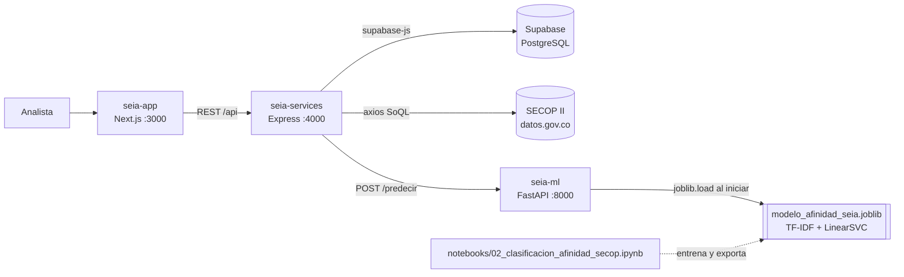

# SEIA — Sistema Estratégico de Inteligencia y Automatización en Contratación

SEIA busca, filtra y prioriza procesos de contratación pública de **SECOP II** para MGD Bitforge S.A.S. Su componente de Inteligencia Artificial es un **modelo NLP entrenado con 166.097 contratos reales**, que calcula **en vivo** qué tan afín es cada proceso al portafolio de la empresa: gestión documental, archivística y tecnología SGDEA.

| Componente | Tecnología | Puerto | Responsabilidad |
|---|---|---|---|
| `seia-app` | Next.js 15, React 19, TypeScript | 3000 | Interfaz: explorador de procesos, clasificador IA, parámetros, documentación |
| `seia-services` | Node.js 22, Express, TypeScript | 4000 | API REST, sincronización con SECOP II, Supabase y pasarela hacia la IA |
| `seia-ml` | Python 3.12, FastAPI, scikit-learn | 8000 | Inferencia del modelo de afinidad **ya entrenado** |
| Supabase | PostgreSQL gestionado | — | Tablas `parametros_busqueda`, `procesos_secop`, `historial_filtros` |
| SECOP II (datos.gov.co) | API SODA (Socrata) | — | Procesos reales (`p6dx-8zbt`) y contratos para entrenar (`jbjy-vk9h`) |



Documentación complementaria:
- [docs/DOCUMENTO_TECNICO.md](docs/DOCUMENTO_TECNICO.md): arquitectura, tecnologías y justificación de cada una.
- [docs/GUIA_DEMO_SUSTENTACION.md](docs/GUIA_DEMO_SUSTENTACION.md): guion de la demostración en vivo y preguntas técnicas.
- [notebooks/README.md](notebooks/README.md): notebooks de Machine Learning (clustering y clasificación).
- [seia-ml/README.md](seia-ml/README.md): servicio de inferencia y cómo cargar el modelo.
- [openspec/](openspec/): especificaciones validadas con OpenSpec.

---

## 1. Requisitos

| Opción | Necesitas |
|---|---|
| **A. Docker** (recomendada) | Docker Desktop 4.x con Docker Compose v2 |
| **B. Local** | Node.js 22+, npm 10+, Python 3.9+ (3.12 recomendado) y `pip` |

Conexión a internet para Supabase y datos.gov.co.

## 2. Configuración (una sola vez)

```bash
cp seia-services/.env.example seia-services/.env
```

```bash
cp seia-app/.env.example seia-app/.env.local
```

Variables principales de `seia-services/.env`:

| Variable | Valor por defecto | Descripción |
|---|---|---|
| `SUPABASE_URL` / `SUPABASE_ANON_KEY` | proyecto SEIA | Conexión a PostgreSQL en Supabase |
| `SECOP_API_URL` | `https://www.datos.gov.co/resource/p6dx-8zbt.json` | Procesos de SECOP II que se sincronizan |
| `SEIA_ML_URL` | `http://localhost:8000` | URL del servicio de IA (Docker la reemplaza por `http://seia-ml:8000`) |
| `SEIA_ML_TIMEOUT_MS` | `5000` | Tiempo de espera de la inferencia |

**Base de datos.** Si las tablas no existen en tu proyecto de Supabase, ejecuta [`seia-services/supabase/schema.sql`](seia-services/supabase/schema.sql) en el *SQL Editor* de Supabase. En el proyecto actual **falta crear `historial_filtros`**: mientras no exista, la vista "Historial de Filtros" queda vacía y `GET /api/historial` responde 500.

## 3. Ejecución

### Opción A — Docker Compose

```bash
docker compose up --build
```

Abre http://localhost:3000. Compose arranca primero `seia-ml` y espera a que su *healthcheck* indique que el modelo está cargado. Después arranca `seia-services` y por último `seia-app`.

### Opción B — Local (tres terminales)

**Terminal 1 — Servicio de IA (`seia-ml`)**

```bash
cd seia-ml && python3 -m venv .venv && source .venv/bin/activate && pip install -r requirements-dev.txt
```

```bash
cd seia-ml && source .venv/bin/activate && uvicorn app.main:app --port 8000
```

**Terminal 2 — Backend (`seia-services`)**

```bash
cd seia-services && npm install && npm run dev
```

**Terminal 3 — Frontend (`seia-app`)**

```bash
cd seia-app && npm install && npm run dev
```

## 4. Verificación rápida

| Qué comprobar | Cómo |
|---|---|
| El modelo está cargado | `curl http://localhost:8000/salud` debe devolver `"modelo_cargado": true` |
| El backend llega a la IA | `curl http://localhost:4000/api/ia/estado` debe devolver `"disponible": true` y las métricas del modelo |
| Clasificación en vivo | `curl -X POST http://localhost:4000/api/ia/clasificar -H 'Content-Type: application/json' -d '{"texto":"Licenciamiento de software de gestión documental en la nube"}'` |
| Procesos con afinidad | `curl "http://localhost:4000/api/procesos?ordenarPor=afinidad"`: cada proceso trae `afinidad_ia` |
| Documentación interactiva | Swagger del backend: http://localhost:4000/api-docs · Swagger del modelo: http://localhost:8000/docs |
| Interfaz | http://localhost:3000, vistas **Procesos SECOP II** y **Clasificador IA** |

## 5. Pruebas

```bash
cd seia-ml && source .venv/bin/activate && pytest
```

Las 19 pruebas de `seia-ml` cubren:
- que la limpieza de texto sea idéntica a la del notebook;
- la carga del artefacto sin reentrenar y el error cuando falta el archivo;
- las predicciones esperadas y la explicación por términos (reconstruye el puntaje exacto de la SVM);
- la validación de la API (respuestas 422).

```bash
cd seia-services && npm run build
```

```bash
cd seia-services && npx openspec validate --all --strict
```

## 6. Modelo de IA: cargar sin reentrenar

El modelo se entrena **una sola vez** en [`notebooks/02_clasificacion_afinidad_secop.ipynb`](notebooks/02_clasificacion_afinidad_secop.ipynb), que lo exporta con `joblib`. La versión que usa la aplicación está en [`seia-ml/modelo/modelo_afinidad_seia.joblib`](seia-ml/modelo/), junto a sus [`metadatos.json`](seia-ml/modelo/metadatos.json), que guardan las métricas, los umbrales y las versiones de las librerías. Para usarlo desde cualquier script de Python:

```python
import joblib
from app.modelo import limpiar_texto            # misma limpieza del notebook (seia-ml/app/modelo.py)

artefacto = joblib.load("seia-ml/modelo/modelo_afinidad_seia.joblib")
vectorizador, modelo = artefacto["vectorizador"], artefacto["modelo"]
puntaje = modelo.decision_function(vectorizador.transform([limpiar_texto("Soporte de software SGDEA")]))[0]
print("Afín" if puntaje > artefacto["umbral"] else "No afín", round(puntaje, 3))
```

| Métrica (20 % de prueba, 33.220 contratos) | Valor |
|---|---|
| Accuracy | 0,984 |
| Precision (clase afín) | 0,646 |
| Recall (clase afín) | 0,692 |
| F1-Score (clase afín) | 0,668 |
| ROC-AUC | 0,966 |

## 7. API REST (resumen)

| Método | Ruta | Descripción |
|---|---|---|
| GET | `/api/salud` | Estado del backend y de la conexión con Supabase |
| GET/POST/PUT/DELETE | `/api/parametros[/:id]` | CRUD de parámetros de búsqueda |
| GET | `/api/procesos?ordenarPor=afinidad` | Procesos de Supabase con `afinidad_ia` calculada en vivo |
| POST | `/api/procesos/sincronizar` | Trae procesos nuevos desde SECOP II según los parámetros activos |
| PATCH/DELETE | `/api/procesos/:id` | Seguimiento interno y eliminación |
| GET/POST/DELETE | `/api/historial[/:id]` | Auditoría de sincronizaciones |
| GET | `/api/ia/estado` | Disponibilidad del servicio de IA y ficha del modelo |
| POST | `/api/ia/clasificar` | Clasificación en vivo de uno o varios objetos contractuales |

El contrato completo está en [`seia-services/openapi.yaml`](seia-services/openapi.yaml) y se sirve en `/api-docs`.

## 8. Especificación con OpenSpec

El proyecto se desarrolla con el flujo *spec-driven* de [OpenSpec](https://github.com/Fission-AI/OpenSpec): proponer, implementar, validar y archivar.

| Capacidad | Especificación |
|---|---|
| `parametros-busqueda` | [openspec/specs/parametros-busqueda/spec.md](openspec/specs/parametros-busqueda/spec.md) |
| `procesos-secop` | [openspec/specs/procesos-secop/spec.md](openspec/specs/procesos-secop/spec.md) |
| `historial-filtros` | [openspec/specs/historial-filtros/spec.md](openspec/specs/historial-filtros/spec.md) |
| `clasificacion-afinidad` | [openspec/specs/clasificacion-afinidad/spec.md](openspec/specs/clasificacion-afinidad/spec.md) |

El historial de cambios está en [`openspec/changes/archive/`](openspec/changes/archive/). El último es `integracion-modelo-ia-afinidad`.

## 9. Estructura del repositorio

```text
seia/
├── seia-app/            Frontend Next.js (vistas, componentes, cliente de API)
├── seia-services/       Backend Express (rutas, controladores, secopFetcher, clienteIA, OpenAPI)
├── seia-ml/             Servicio de IA FastAPI + modelo entrenado (.joblib) + pruebas
├── notebooks/           Notebooks de Colab: clustering (01) y clasificación (02)
├── openspec/            Especificaciones, cambios archivados y contrato de la API
├── docs/                Documento técnico y guía de demostración
└── docker-compose.yml   Orquestación de los tres servicios
```

## 10. Solución de problemas

| Síntoma | Causa probable y solución |
|---|---|
| Insignias "IA no disponible" en las tarjetas | `seia-ml` no está corriendo o `SEIA_ML_URL` es incorrecta. Verifica con `curl http://localhost:8000/salud` |
| `seia-ml` no arranca: "No se encontró el modelo entrenado" | Falta `seia-ml/modelo/modelo_afinidad_seia.joblib`. Recupéralo del repositorio o expórtalo desde el notebook 02 |
| Error al cargar el `.joblib` por versión | Instala exactamente `scikit-learn==1.6.1` (está en `requirements.txt`) |
| "Historial de Filtros" vacío o `GET /api/historial` responde 500 | Crea la tabla con `seia-services/supabase/schema.sql` |
| La sincronización con SECOP II tarda o falla | El API de datos.gov.co limita las solicitudes anónimas. Configura `SECOP_APP_TOKEN` |
