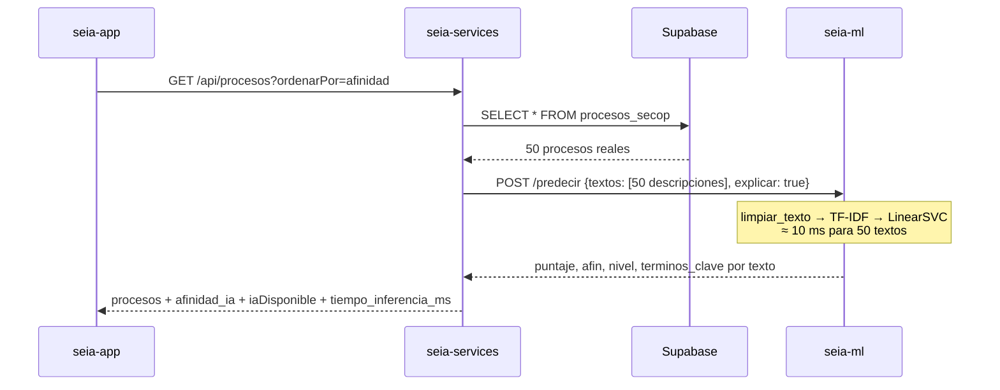
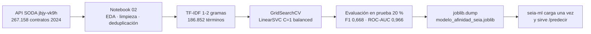

# Documento técnico y arquitectónico — SEIA

**Proyecto:** SEIA, Sistema Estratégico de Inteligencia y Automatización en Contratación
**Cliente de referencia:** MGD Bitforge S.A.S. (gestión documental, archivística y tecnología SGDEA)
**Metodología de especificación:** OpenSpec (*spec-driven development*)
**Versión del documento:** 1.0, noviembre de 2026

---

## 1. Problema y solución

Cada día se publican en SECOP II cientos de procesos de contratación pública. Un analista de licitaciones de MGD Bitforge necesita encontrar los que encajan con su portafolio, pero:
- los **filtros por código UNSPSC fallan**, porque las entidades usan códigos genéricos. Por ejemplo, un desarrollo de software queda registrado como "servicios de personal" (familia 8011);
- las **palabras clave** no captan sinónimos ni el contexto de la frase.

**SEIA** sincroniza los procesos reales desde los Datos Abiertos de SECOP II hacia Supabase. Sobre esos procesos aplica un **modelo de Inteligencia Artificial (NLP)** que **lee el objeto contractual** y calcula **en vivo**, en cada consulta, su afinidad con el portafolio. Para cada proceso, la interfaz muestra:
- un **puntaje**;
- un **nivel**: Alta, Media o Baja;
- los **términos que explican la decisión**.

Con eso el analista puede priorizar los procesos y validar el razonamiento del modelo.

## 2. Arquitectura

### 2.1 Vista de componentes

```mermaid
flowchart LR
    subgraph Cliente
        U[Analista de licitaciones]
    end
    subgraph Docker Compose · red seia-net
        APP[seia-app<br/>Next.js 15 · :3000]
        API[seia-services<br/>Express · :4000]
        ML[seia-ml<br/>FastAPI · :8000]
    end
    DB[(Supabase<br/>PostgreSQL)]
    SECOP[(SECOP II · datos.gov.co<br/>API SODA)]
    MOD[[modelo_afinidad_seia.joblib]]
    NB[[Notebook 02 · Google Colab]]

    U --> APP
    APP -- "REST JSON /api/*" --> API
    API -- "supabase-js" --> DB
    API -- "axios · SoQL" --> SECOP
    API -- "POST /predecir (lote)" --> ML
    ML -- "joblib.load al iniciar" --> MOD
    NB -. "entrenamiento y exportación" .-> MOD
```

La arquitectura usa **microservicios por responsabilidad**:

| Capa | Servicio | Responsabilidad | Por qué separarla |
|---|---|---|---|
| Presentación | `seia-app` | Interfaz, estado de la vista, visualización de la afinidad | El frontend evoluciona independiente del backend; Next.js optimiza el empaquetado |
| Aplicación / API | `seia-services` | Reglas de negocio, persistencia, integración con SECOP II, pasarela hacia la IA | Un solo punto de entrada para el navegador: el servicio de IA no queda expuesto al público |
| Inteligencia Artificial | `seia-ml` | Cargar el modelo entrenado y hacer la inferencia | El modelo es un objeto de scikit-learn (Python). Aislarlo permite escalarlo, versionarlo y reemplazarlo sin tocar la API |
| Datos | Supabase | Persistencia de parámetros, procesos e historial | PostgreSQL gestionado, sin operar un servidor de base de datos |

### 2.2 Flujo de una consulta con IA en vivo



**Degradación controlada:** si `seia-ml` no responde en 5 s, `seia-services` devuelve los procesos con `afinidad_ia: null` e `iaDisponible: false`. La aplicación sigue funcionando y la interfaz muestra "IA no disponible".

### 2.3 Ciclo de vida del modelo



## 3. Tecnologías y justificación

### 3.1 Lenguajes

| Lenguaje | Dónde se usa | Por qué |
|---|---|---|
| **TypeScript** | `seia-app` y `seia-services` | El tipado estático detecta en compilación los errores de contrato entre frontend y backend; por ejemplo, la forma de `afinidad_ia` está tipada en ambos lados. Hay un solo lenguaje en las dos capas web |
| **Python 3** | `seia-ml` y notebooks | Es el ecosistema estándar de ciencia de datos (pandas, scikit-learn). El modelo se serializa como un objeto Python, así que servirlo en Python evita conversiones frágiles |
| **SQL (PostgreSQL)** | `schema.sql` en Supabase | Modelo relacional con integridad (claves únicas como `uid_secop`) para evitar procesos duplicados |
| **YAML / JSON** | OpenAPI, OpenSpec, Docker Compose | Formatos declarativos y legibles para los contratos de API y la infraestructura |

### 3.2 Frontend (`seia-app`)

| Tecnología | Versión | Para qué | Por qué la elegimos |
|---|---|---|---|
| **Next.js (App Router)** | 15 | Framework de React con enrutamiento y compilación optimizada | Build `standalone` listo para Docker, enrutamiento por carpetas (`/`, `/documentacion`) y optimización automática del bundle |
| **React** | 19 | Componentes de la interfaz | Estándar de la industria. Su modelo declarativo simplifica el estado (filtros, vista activa, estado de la IA) |
| **CSS Modules** | — | Estilos aislados por componente | Evitan colisiones de clases sin agregar dependencias. Los tokens de diseño viven en `globals.css` (tipografía Century Gothic y acento `#5c1219`, según `PRODUCT.md`) |
| **Framer Motion** | 11 | Animaciones de resorte | Transiciones suaves entre vistas y tarjetas sin escribir animaciones a mano |
| **Lucide React** | 0.469 | Iconografía | Iconos SVG livianos y consistentes; se cargan solo los que se usan |
| **Sonner** | 1.7 | Notificaciones | Avisa de éxitos y errores (por ejemplo, "IA no disponible") sin bloquear la interfaz |

### 3.3 Backend (`seia-services`)

| Tecnología | Versión | Para qué | Por qué la elegimos |
|---|---|---|---|
| **Node.js** | 22 | Entorno de ejecución | E/S no bloqueante, ideal para una API que orquesta llamadas a Supabase, SECOP II y la IA. Mismo lenguaje que el frontend |
| **Express** | 4.21 | Servidor HTTP y enrutamiento | Minimalista y maduro, con middlewares para todo lo necesario |
| **@supabase/supabase-js** | 2.48 | Cliente de base de datos | Acceso tipado a PostgreSQL en Supabase, con `upsert` por `uid_secop` para no duplicar procesos |
| **Axios** | 1.7 | Cliente HTTP | Consultas SoQL a SECOP II y llamadas a `seia-ml`, con tiempos de espera configurables (5 s hacia la IA) |
| **Zod** | 3.24 | Validación de entradas | Valida el cuerpo de `POST /api/ia/clasificar` (texto o lista de 1 a 200) y devuelve 422 con un mensaje claro |
| **Helmet, CORS, Morgan** | — | Seguridad, CORS y registro de solicitudes | Cabeceras de seguridad, origen permitido solo desde la app y trazas de cada solicitud para la demo |
| **Swagger UI Express + YAML** | 5.0 / 2.7 | Documentación viva de la API | Publica en `/api-docs` el contrato OpenAPI 3.1 alineado con OpenSpec |
| **dotenv** | 16 | Configuración | Separa los secretos y las URL del código (`.env`, que no se versiona) |

### 3.4 Inteligencia Artificial (`seia-ml` y notebooks)

| Tecnología | Versión | Para qué | Por qué la elegimos |
|---|---|---|---|
| **Google Colab / Jupyter** | — | Exploración, entrenamiento y evaluación | Entrega reproducible (`.ipynb`) con código, gráficas y métricas; Colab no requiere instalar nada |
| **pandas / NumPy** | 2.x | Manipulación de datos | Limpieza, deduplicación y análisis exploratorio de 267.158 contratos |
| **scikit-learn** | 1.6.1 | `TfidfVectorizer`, `LinearSVC`, `GridSearchCV`, métricas | Es la biblioteca de referencia para ML clásico, con API uniforme y modelos eficientes en texto disperso. La versión está fijada para cargar el artefacto sin incompatibilidades |
| **joblib** | 1.5 | Serializar el modelo entrenado | Guarda de forma eficiente los objetos de scikit-learn con matrices NumPy grandes. Permite **cargar el modelo sin reentrenar** |
| **FastAPI** | 0.115 | API de inferencia | Valida las entradas con Pydantic (422 automático), genera la documentación en `/docs` y tiene un ciclo de vida (`lifespan`) para cargar el modelo una sola vez |
| **Uvicorn** | 0.32 | Servidor ASGI | Ligero y rápido para servir FastAPI |
| **pytest + httpx** | 8.3 / 0.28 | Pruebas automatizadas | 19 pruebas del modelo y de la API con `TestClient` |
| **Matplotlib / Seaborn** | — | Gráficas en los notebooks | Matriz de confusión, curvas PR y ROC, coeficientes del modelo |

#### Selección del modelo de IA

| Decisión | Alternativas evaluadas | Justificación |
|---|---|---|
| **Representación TF-IDF (unigramas y bigramas)** | Conteo simple, embeddings | Captura expresiones como "gestion documental" o "licencias software". Es interpretable y rápida, y no requiere GPU |
| **LinearSVC** (SVM lineal) | Dummy (clase mayoritaria), Complement Naive Bayes | Mejor F1 en validación cruzada (0,66 frente a 0,48 de Naive Bayes y 0 de Dummy). Es eficaz en espacios dispersos de alta dimensión (≈187.000 términos). No es Regresión Lineal, que el enunciado prohíbe |
| **`class_weight='balanced'`, `C=1`** | `C ∈ {0,3; 1; 3}`, con y sin balanceo | Lo eligió `GridSearchCV` optimizando el F1, porque solo el 2,3 % de los contratos son afines |
| **Explicación `tfidf × coeficiente`** | SHAP, LIME | En un modelo lineal es exacta: el puntaje es la suma de las contribuciones más el sesgo, y lo verifica una prueba automatizada |

### 3.5 Datos e infraestructura

| Tecnología | Para qué | Por qué |
|---|---|---|
| **Supabase (PostgreSQL)** | Persistencia de parámetros, procesos e historial | Base de datos gestionada con API, sin operar un servidor propio. La clave pública es apta para el cliente |
| **API SODA de datos.gov.co** | Fuente de procesos (`p6dx-8zbt`) y de contratos para entrenar (`jbjy-vk9h`) | Datos públicos oficiales de Colombia Compra Eficiente, consultables con SoQL |
| **Docker y Docker Compose** | Empaquetado y orquestación de los 3 servicios | Un solo `docker compose up --build` levanta el sistema. El *healthcheck* de `seia-ml` garantiza que el backend arranque con el modelo cargado |
| **Git + GitHub** | Control de versiones y Pull Requests | Trabajo en ramas (`dev_nicolas`) con revisión por PR |

### 3.6 Ingeniería y especificación

| Herramienta | Para qué | Cómo ayuda |
|---|---|---|
| **OpenSpec (@fission-ai/openspec 1.17)** | Desarrollo guiado por especificaciones | Cada cambio se **propone** (propuesta, diseño, *spec deltas* y tareas), se **implementa**, se **valida** con `openspec validate --all --strict` y se **archiva**, fusionando los requisitos en `openspec/specs/`. Los requisitos usan SHALL/MUST y escenarios WHEN/THEN verificables |
| **OpenAPI 3.1** | Contrato de la API REST | Fuente única de verdad para el frontend y para quien consuma la API |

## 4. Diseño del servicio de IA

| Aspecto | Decisión |
|---|---|
| Carga del modelo | Una sola vez, en `lifespan` de FastAPI. Si falta el `.joblib`, el servicio **no arranca** (falla visible) |
| Preprocesamiento | `limpiar_texto()` replica exactamente la limpieza del notebook: minúsculas, sin tildes, sin signos ni números aislados. Una prueba lo verifica |
| Inferencia | Por lotes de hasta 200 textos. `decision_function` devuelve la distancia al hiperplano |
| Umbrales | `Alta` si el puntaje es mayor que 0 (punto balanceado del notebook). `Media` si está entre −0,44 y 0 (recall ≥ 80 %, para revisión manual). `Baja` si es menor que −0,44 |
| Explicación | Los 6 términos de mayor \|tfidf × coeficiente\| |
| Endpoints | `GET /salud`, `GET /modelo` (métricas, umbrales, datos de entrenamiento), `POST /predecir` |
| Validación | Pydantic: entre 1 y 200 textos, sin textos vacíos, hasta 5.000 caracteres. Si no se cumple, responde HTTP 422 |

## 5. Calidad y pruebas

| Tipo | Herramienta | Qué verifica |
|---|---|---|
| Unitarias del modelo | pytest | Limpieza idéntica al notebook, carga sin reentrenar, artefacto ausente, predicciones de referencia, explicación exacta, orden de los lotes |
| API de IA | pytest + `TestClient` | `/salud`, `/modelo`, `/predecir` y los errores 422 |
| Tipado | `tsc` | Contratos de tipos entre las capas (`npm run build`, `tsc --noEmit`) |
| Especificaciones | OpenSpec | `openspec validate --all --strict` |
| Integración | curl y navegador | Flujo completo seia-app → seia-services → seia-ml con procesos reales de Supabase |

## 6. Seguridad y privacidad

- El servicio de IA no se expone al navegador: solo `seia-services` lo invoca.
- Los secretos van en `.env`, que no se versiona. Solo se publica la clave *publishable* de Supabase, pensada para el cliente.
- Los notebooks **no descargan datos personales** de contratistas (nombres, documentos).
- Las entradas se validan en ambas capas (Zod y Pydantic).

## 7. Limitaciones conocidas

1. **Ruido de etiquetas.** La variable objetivo sale de códigos UNSPSC asignados por las entidades, así que la precision medida (0,65) es una cota inferior: muchos "falsos positivos" son contratos de TI mal codificados.
2. **Gestión documental subrepresentada.** El 97 % de los ejemplos afines son de tecnología. Por eso los textos de archivo suelen quedar en el nivel `Media` y conviene etiquetar más ejemplos.
3. **El modelo no aprende en línea.** Hay que reentrenarlo periódicamente con datos nuevos usando el notebook.
4. **Dependencia de versión.** El `.joblib` requiere `scikit-learn==1.6.1`.
5. **Tabla `historial_filtros`.** En el proyecto de Supabase actual hay que crearla con `schema.sql`.
